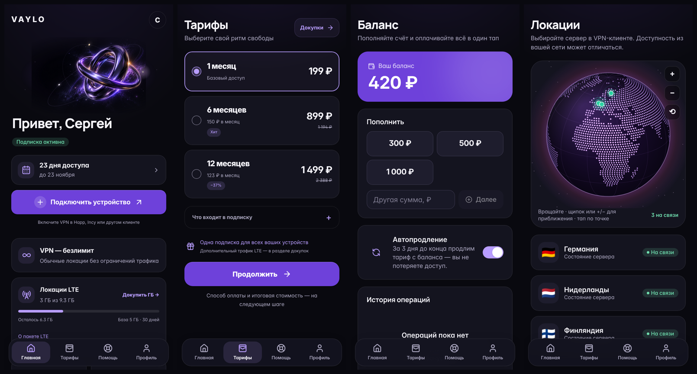
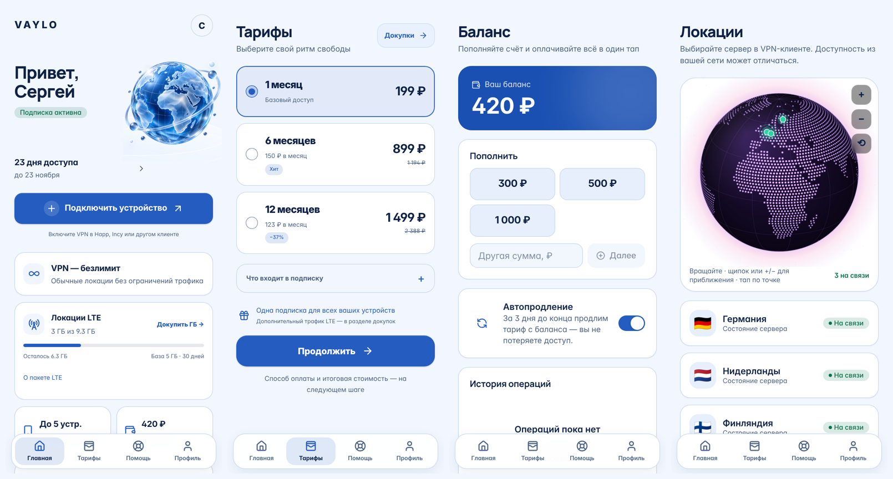

<div align="center">

Последнее обновление: [v65 — Design v2](docs/changelog/DESIGN-V2.md) · [все изменения](docs/changelog/).

# VAYLO — платформа продажи VPN-подписок

Telegram-бот · Mini App · веб-кабинет · админ-панель · автоустановщики

[](https://github.com/foecerip2/vaylo/actions/workflows/ci.yml)
[](LICENSE)


</div>

> **English in short.** VAYLO is a self-hosted platform for selling VPN subscriptions on top of the
> [Remnawave](https://github.com/remnawave) panel: Telegram bot, Telegram Mini App (web cabinet), admin panel,
> payments (YooKassa, Platega, RollyPay), referrals, promo codes, campaigns, and one-command installers for the
> platform, the Remnawave panel and VPN nodes. The UI is Russian-only. Licensed under MIT.

---

## Скриншоты Mini App

Две темы оформления, которые владелец выбирает в админке (**Настройки → Оформление**). Design v2 — «тихая точность»: плоские поверхности, один акцент, чёткая типографика.

**Orbit Signature** (тёмная)



**Arctic Glass** (светлая)



<sub>Скриншоты сняты на демонстрационных данных.</sub>


## Что это

Готовая платформа для запуска собственного VPN-сервиса на базе панели **Remnawave**. Пользователь получает
пробный период, выбирает тариф, платит и подключает приложение в пару нажатий — всё внутри Telegram.
Вы управляете сервисом из админки: пользователи, платежи, тарифы, акции, рассылки, ноды, поддержка.

## Возможности

**Для пользователей**
- Пробный период, тарифы, оплата картой, СБП и криптовалютой, оплата с баланса, автопродление.
- Подключение в один тап: кнопка открывает страницу подписки, где можно выбрать платформу и приложение (Happ, Hiddify, Incy, Streisand и др.).
- Промокоды, реферальная система в 2 уровня с рангами, квесты и ежедневный бонус.
- Докупка устройств, трафика и премиум-локаций; интерактивная карта серверов.
- AI-помощник поддержки с передачей диалога человеку.

**Для администратора**
- Обзор с графиками, пользователи (продление, бан, баланс, сброс ссылки), платежи (перепроверка, сверка выручки, экспорт CSV).
- Акции: компенсации всем, скидки на тарифы и пополнение, бонусы к пополнению.
- Тарифы, промокоды, рассылки по сегментам, настройки платёжных систем и Remnawave с проверкой подключения.
- Роли администраторов, 2FA, журнал действий, мониторинг с оповещениями и авто-техработами.
- Восстановление пользователей в Remnawave после потери панели (с сохранением ссылок подписок).
- Адаптивная админка, удобная и с телефона.

**Платежи**
- ЮKassa, Platega, RollyPay. Платежи идемпотентны: webhook → проверка статуса через API провайдера → однократная выдача; страховочный опрос каждую минуту.
- Секреты хранятся зашифрованно (AES-256-GCM) и скрыты в интерфейсе.

## Быстрый старт

Нужен чистый сервер Ubuntu 22.04/24.04 (или Debian 12) и домен с A-записями `app.`, `admin.`, `panel.`, `sub.` на IP сервера.

```bash
git clone https://github.com/foecerip2/vaylo.git vpn-platform && cd vpn-platform
sudo bash scripts/install.sh
```

Установщик сам поставит Docker, соберёт проект, выпустит HTTPS-сертификаты и создаст администратора.
Подробности — в [INSTALL.md](INSTALL.md).

| Скрипт | Для чего |
|---|---|
| `scripts/install.sh` | Установка и обновление платформы (`--update`) |
| `scripts/install-remnawave.sh` | Панель Remnawave: HTTPS, админ, API-токен, профиль Xray (VLESS Reality), сквад |
| `scripts/install-node.sh` | VPN-нода: регистрация в панели, запуск `remnanode`, файрвол, хост для подписок |
| `scripts/install-cdn.sh` | Origin для обхода блокировок через CDN (Яндекс Cloud CDN): nginx + Xray XHTTP, профиль, нода, хост |
| `scripts/backup.sh` / `scripts/restore.sh` | Резервные копии и восстановление |
| `scripts/cleanup.sh` | Автоочистка старых бэкапов и мусора |

Подключить ноду:

```bash
sudo bash scripts/install-node.sh --panel https://panel.example.com --token <API-токен> --name Finland --country FI --yes
```

## Состав

| Часть | Каталог | Технологии |
|---|---|---|
| API + воркер | `apps/api` | Fastify 5, PostgreSQL, Redis/BullMQ, zod |
| Telegram-бот | `apps/bot` | grammY (webhook) |
| Mini App / кабинет | `apps/app` | React, Vite, Tailwind |
| Админка | `apps/admin` | React, Vite, Tailwind, Recharts |
| Общий код и дизайн-система | `packages/shared`, `packages/ui` | TypeScript |
| Деплой | `deploy/` | Docker Compose, Caddy (авто-HTTPS) |
| Установщики | `scripts/` | Bash |

Документация: [INSTALL.md](INSTALL.md), [акции](docs/CAMPAIGNS.md), [AI-поддержка](docs/SUPPORT-AI.md), [восстановление Remnawave](docs/RESTORE-REMNAWAVE.md), [обход через CDN](docs/CDN-YANDEX.md).

## Разработка

```bash
pnpm install
pnpm -r typecheck && pnpm -r test && pnpm -r build
pnpm --filter @vpn/api exec tsx test/helpers/devstack.ts   # API + моки внешних сервисов на :3000
pnpm --filter @vpn/app dev      # :5173
pnpm --filter @vpn/admin dev    # :5174  (admin@example.com / admin-password-123)
```

Для тестов нужны PostgreSQL и Redis. Интеграции с Remnawave и платёжными системами покрыты тестами на локальных моках; мок Remnawave проверяет запросы схемами официального пакета `@remnawave/backend-contract`.

## Важно знать

- Проект не связан с командой Remnawave и платёжными сервисами; названия принадлежат их владельцам.
- Вы сами отвечаете за соответствие вашего сервиса законам вашей страны и правилам платёжных провайдеров и Telegram.
- Интеграция с RollyPay написана по открытой документации; перед запуском проверьте оплату в тестовом режиме.
- Интерфейс только на русском языке.

## Участие и безопасность

Предложения и исправления приветствуются — см. [CONTRIBUTING.md](CONTRIBUTING.md). Об уязвимостях сообщайте приватно — см. [SECURITY.md](SECURITY.md).

## Лицензия

[MIT](LICENSE) © 2026 Sergey (VAYLO). При использовании и распространении сохраняйте уведомление об авторстве и текст лицензии.
